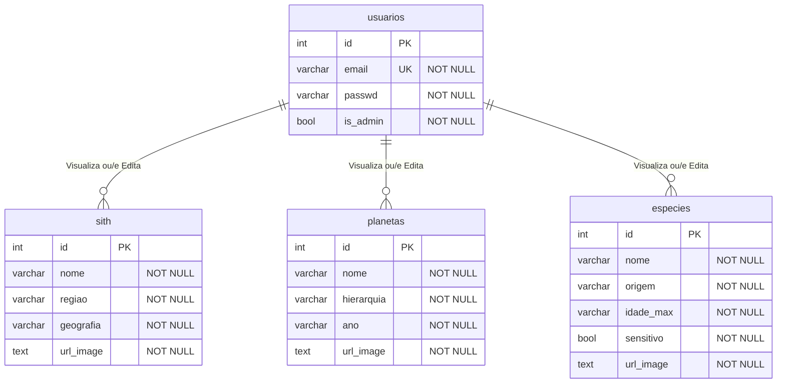
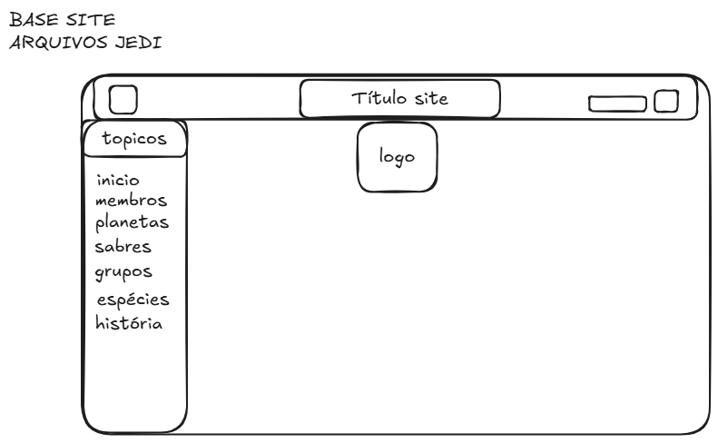

<h1 align="center">Arquivos Jedi</h1>

<h2 align="center">Wiki do Universo de Star Wars</h2>

O sistema Arquivos Jedi se trata de uma wiki para o armazenamento de informações sobre a franquia, incluindo informações como espécies, grupos e siths, além de outras informações complementares.
Desenvolvido em PHP para banco de dados PostgreSQL, o sistema funciona com base em três CRUDs.

---

## 1 - Como executar o projeto

Para rodar este projeto, é necessário ter instalado em sua máquina o PHP e o PostgreSQL

## 1.1 - Pré-Requisitos 
- PHP v8.5 - Extentão pdo_pgsql ativada
- PostgreSQL instalado e rodando na porta 5432
- Git instalado

## 1.2 - Instalação

### Passo 1 - Clonar Repositório

```bash
# Copie o reposítório no GitHub
git clone https://github.com/FelipeFerreiraRodrigues/arq_jedi

# Abra o arquivo clonado
cd arq_jedi
```

### Passo 2 - Configurar o Banco de Dados

O projeto deve possuir um arquivo SQL localizado dentro da pasta database, nela esta a estrutura do Banco de Dados que sera utilizada pelo backend

Siga o passo a passo para criar o banco de dados:

#### 1 - Abra o powershell/terminal
#### 2 - Conecte no Postgres usando o usuário postgres

```bash
psql -U postgres
```

#### 3 - Se o banco ja existir, delete e recrie usando os comandos abaixo:

```sql
DROP DATABASE IF EXISTS jediarch;
CREATE DATABASE jediarch;
```

#### 4 - Crie um usuário específico para gerenciar o Banco de Dados, ainda no postgres use os comandos:

```sql
CREATE USER jediarch WITH PASSWORD '*senha*';
ALTER DATABASE jediarch OWNER TO jediarch;
\q
```

#### 5 - Após mudar o dono do Banco de Dados, abriremos a pasta "dump", rodando os seguintes comandos para restauras as tabelas e registros:

```bash
cd dump/
# O arquivo ira recuperar as estruturas
psql -U jediarch -h localhost -d jediarch -f placeholder.sql

cd..
```

### Passo 3 - Configurar conexão PHP
Pelo seu editor de código preferido, abra o arquivo "connect.php", editando somente o campo necessário:

```php
$host = "localhost";
$dbname = "jediarch";
$user = "jediarch";
$password = "senha do postgres (jediarch) aqui"; # Altere somente esse campo!!!
```

### Passo 4 - Acessar localmente
Depois de todos esses passos, você deve abrir o terminal, rodando os seguintes comandos:
```bash
# Caso não esteja na raiz do projeto
cd arq_jedi
# Para rodar o sistema localmente
php -S localhost:8000
```

Assim, o sistema rodará no navegador na URL "localhost:8000".

### Passo Extra - Logins

```
User | Email - teste@gmail.com | Senha - 123 |
Adm | Email - zyfovias@jediordem.com | Senha - 123456 |
 
```

## 2 - Estrutura dos Diretórios

```bash
arq_jedi/
│
├── index.php                             # Página inicial do sistema
├── README.md                            # Documentação principal
│
├── database/                            # Conexão e funções do banco de dados
│   ├── connect.php                      # Conexão PDO com PostgreSQL
│   └── function.php                     # Funções do sistema
│
├── headerfooter/                        # Includes essenciais
│   ├── aside.php                        # Menu lateral
│   ├── footer.php                       # Rodapé
│   └── header.php                       # Cabeçalho
│
├── imagens/                             # Imagens
│
├── login/                               # Controle de sessão e controle de acesso
│   ├── cadastrar.php                    # Cadastro de usuários
│   ├── confidencial.php                 # Login de pagina restrita
│   ├── login.php                        # Login de usuários
│   ├── logout.php                       # Encerramento de sessão
│   ├── vefadm.php                       # Validação de usuário adm
│   └── vefuser.php                      # Validação de usuário comum
│
├── pages/                               # CRUDs
│   ├── especies.php                     # Apresentação das especies
│   ├── especies2/                       # Gestão administrativa de espécies
│   │   ├── asideesp.php                 # Navegação secundária de espécies
│   │   ├── espcreate.php                # Cadastro de espécie
│   │   ├── espdelete.php                # Exclusão de espécie
│   │   ├── espread.php                  # Prints de espécie
│   │   ├── espreads.php                 # Read de ID de espécies
│   │   ├── espupdate.php                # Alteração de dados de espécie
│   │   └── upload/                      # Imagens enviadas
│   │
│   ├── grupos.php                       # Apresentação de grupos
│   ├── grupos2/                         # Gestão de grupos (Sith e Mandalorianos)
│   │   ├── intro.php                    # Visão geral dos grupos
│   │   ├── mando/                       # Seção dedicada aos Mandalorianos
│   │   └── sith/                        # CRUD da Ordem Sith
│   │       ├── asidesith.php            # Navegação secundária de Sith
│   │       ├── sithcreate.php           # Cadastro de Sith
│   │       ├── sithdelete.php           # Exclusão de Sith
│   │       ├── sithread.php             # Prints de Sith
│   │       ├── sithreads.php            # Read de ID de Sith
│   │       ├── sithupdate.php           # Alteração de dados de Sith
│   │       └── upload/                  # Imagens enviadas
│   │
│   ├── membros.php                      # Apresentação dos membros
│   ├── membros2/                        # Gestão administrativa de membros
│   │   └── listagem.php                 # Tabela de registros de membros
│   │
│   ├── planetas.php                     # Apresentação de planetas
│   ├── planetas2/                       # CRUD de planetas
│   │   ├── asideplan.php                # Navegação secundária de planetas
│   │   ├── plancreate.php               # Cadastro de planetas
│   │   ├── plandelete.php               # Exclusão de planetas
│   │   ├── planread.php                 # Prints de planetas
│   │   ├── planreads.php                # Read de ID de planetas
│   │   └── planupdate.php               # Read de ID de planetas
│   │
│   └── sabres.php                       # Catálogo de sabres de luz
│
└── style/                               # Folhas de estilo CSS
    └── style.css                        # Estilização global
```

## 3 - Especificação de Requisitos

### 3.1 - Requisitos Funcionais

| ID | Título | Descrição | Prioridade | Feito? |
|----|--------|-----------|------------|---------|
| **RF01** | Autenticação de Usuário | O sistema deve autenticar via email e senha | Alta |✅|
| **RF02** | Cadastro de Usuários | Permitir novo registro de usuários com campos obrigatórios | Alta | ✅ |
| **RF03** | Controle de Perfil | Restringir páginas de edição e cadastro exclusivo a administradores | Alta | ✅ |
| **RF04** | CRUDs | Cadastrar, visualizar, editar e remover espécies, planetas, e outros registros | Alta | ✅ |
| **RF05** | Gestão de Membros | Listar e membros, exceto administradores | Média | ✅ |
| **RF06** | Catálogo de Sabres de Luz | Exibir contexto detalhado de sabres de luz e suas características | Baixa | ✅ |
| **RF07** | Encerramento de Sessão | Permitir que o usuário encerre sua sessão | Alta | ✅ |

### 3.2 - Requisitos Não-Funcionais


| ID | Título | Descrição | Prioridade | Feito? |
|----|--------|-----------|------------|--------|
| **RNF01** | Linguagem | Desenvolvido em PHP em versão 8.5 | Alta | ✅ |
| **RNF02** | Banco de Dados | Utilização do PostgreSQL | Alta | ✅ |
| **RNF03** | Interface Temática | Layout customizado com CSS inspirado na estética de Star Wars | Baixa | ✅ |
| **RNF04** | Segurança de Sessão | Controle e verificação constante de sessão | Alta | ✅ |

### 3.3 - Regras de Negócio

| ID | Regra | Descrição |
|----|-------|-----------|
| **RN01** | Privilégio de Escrita | Usuário só pode ler o acervo, administradores podem atualizar, excluir e criar |
| **RN02** | Email Único | Emails cadastrados devem ser únicos na tabela de usuários |
| **RN03** | Uploads Válidos | Arquivos anexados no cadastro de espécies, planetas ou grupos devem ser armazenados no pastra "upload" correspondente |

## 4 - Estrutura do Banco de Dados

### Tabela: `usuarios`

| Campo | Tipo | Restrições | Descrição |
|-------|------|-----------|-----------|
| id | SERIAL | PRIMARY KEY | ID unico do usuario |
| email | VARCHAR(255) | NOT NULL UNIQUE | Email único para autentificação |
| passwd | VARCHAR(255) | NOT NULL | Senha de acesso |
| is_admin | BOOLEAN | NOT NULL | Nível de acesso |

### Tabela: `especies`

| Campo | Tipo | Restrições | Descrição |
|-------|------|-----------|-----------|
| id | SERIAL | PRIMARY KEY | ID unico da espécie |
| nome | VARCHAR(255) | NOT NULL | Nome da espécie |
| origem | VARCHAR(255) | NOT NULL | Planeta de origem |
| idade_max | VARCHAR(255) | NOT NULL | Idade máxima da espécie |
| sensitivo | BOOLEAN | NOT NULL | Verificação de sensitividade |
| url_image | TEXT | NOT NULL | Caminho da URL/arquivo da imagem |

### Tabela: `planetas`

| Campo | Tipo | Restrições | Descrição |
|-------|------|-----------|-----------|
| id | SERIAL | PRIMARY KEY | ID unico do planeta |
| nome | VARCHAR(255) | NOT NULL | Nome do planeta |
| regiao | VARCHAR(255) | NOT NULL | Região da galaxia que se encontra |
| geografia | VARCHAR(255) | NOT NULL | Geografia do planeta |
| url_image | TEXT | NOT NULL | Caminho da URL/arquivo da imagem |

### Tabela: `sith`

| Campo | Tipo | Restrições | Descrição |
|-------|------|-----------|-----------|
| id | SERIAL | PRIMARY KEY | ID unico do Sith |
| nome | VARCHAR(255) | NOT NULL | Nome do Sith |
| hierarquia | VARCHAR(255) | NOT NULL | Posição na hierarquia Sith |
| Ano | VARCHAR(255) | NOT NULL | Ano em que se tornou Sith e deixou de ser Sith/foi morto |
| url_image | TEXT | NOT NULL | Caminho da URL/arquivo da imagem |

## 5 - Diagramas 

Este sistema CRUD não possui relacionamentos entre suas tabelas, portanto seus diagramas não são interligados por trabalharem separadamente.



## 6 - Prototipagem

### Protótipo de Baixa-Fidelidade



## 7 - Conclusão

Este projeto foi, para mim, desafiador e uma boa oportunidade de aprendizado.


